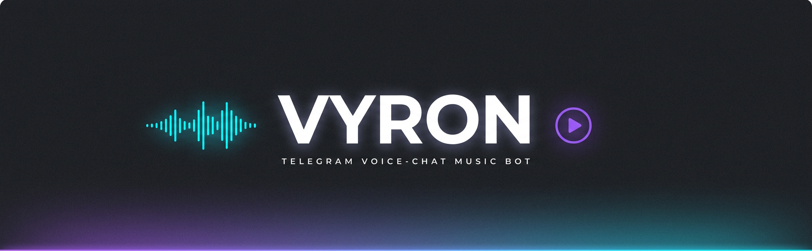
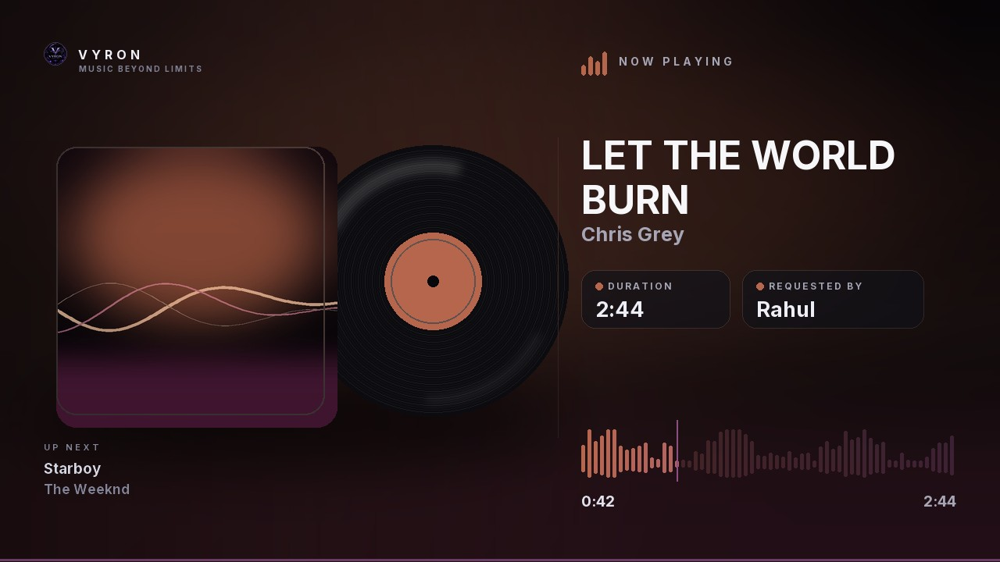

<div align="center">



# VYRON

**A Telegram voice-chat music bot that actually looks good.**

Rich cards · premium emoji · instant search · zero-clutter controls

[](https://python.org)
[](https://github.com/KurimuzonAkuma/kurigram)
[](https://github.com/pytgcalls/pytgcalls)
[](LICENSE)

[Quick start](#-quick-start) · [Commands](#-commands) · [Deploy](#-deploy) · [Premium emoji](#-premium-emoji) · [Architecture](#-architecture)

</div>

---

## ✨ What it does

| | |
|---|---|
| 🎧 **Voice-chat streaming** | Lossless-feeling audio (or video) in any group voice chat, auto-started by the assistant account. |
| 🔎 **Search-first UX** | `/play faded` shows the top 5 results with durations — tap one to stream. Links play instantly. |
| 📜 **Real queue** | Add, remove, reorder, jump, shuffle, loop-off/one/all, autoplay related tracks when the queue empties. |
| 💾 **Downloads** | `/song` and `/video` deliver real MP3/MP4 files with cover art, metadata and a disk cache. |
| 📝 **Lyrics** | Synced or plain lyrics pulled from LRCLIB for whatever is playing. |
| ❤️ **Favourites & history** | Per-user, persistent, shown as tidy tables. |
| ⚙️ **Per-chat settings** | Volume, loop mode, autoplay and 24/7 — saved to Mongo or a JSON file. |
| 🛡️ **Admin-first** | Only group admins (and sudo users) can touch playback; everyone can watch. |
| 🚪 **Self-cleaning** | Leaves idle voice chats, expires stream URLs, purges the download cache, survives restarts. |
| 🛡️ **Group management** | ban · kick · mute · warn (auto-ban at the limit) · purge · pin · promote/demote · welcome & goodbye with placeholders. |
| 🔒 **Content locks + anti-flood** | lock media, links, forwards, stickers, bots, commands, NSFW; flood offenders get deleted and muted. |
| 🎛️ **Audio effects** | bass, treble, nightcore, vaporwave, 8D, echo, karaoke, loudness, speed — as a rich toggle panel. |
| 📡 **Channel play** | `/cplay` streams into the linked channel's voice chat. |
| 🔎 **Inline mode** | `@VyronMusicBot <song>` returns shareable results in any chat. |
| 🌐 **Mini App** | A Spotify-style web player served by the bot: local playback with queue/shuffle/repeat, synced lyrics, a ⌘K command palette and full control of the voice-chat stream. |
| 🔌 **Music API** | An Eldian-compatible `/v1` API on the same URL: downloads, streaming, search, metadata, lyrics and metrics, with hashed keys, scopes, expiry, rotation and per-key rate limits. |

### Built on the *new* Telegram Bot API

VYRON renders its static cards as **rich messages** — real headings, tables and
collapsible sections, not walls of bold text:

```html
<h2>🎧 ᴠʏʀᴏɴ — ɴᴏᴡ ᴘʟᴀʏɪɴɢ</h2>
<blockquote>🎶 <b>Track title</b> · 🎤 Artist</blockquote>
<table>
  <tr><td>🔊 Volume</td><td><b>100%</b></td></tr>
  <tr><td>🔁 Loop</td><td><b>Queue</b></td></tr>
</table>
<footer>page 1/3 · autoplay on</footer>
```

- **Rich messages** with automatic downgrade to classic HTML if a server rejects them.
- **Editable rich cards** — paginated queues keep their formatting instead of degrading to text.
- **Premium emoji** rendered as real `custom_emoji` entities (`<tg-emoji emoji-id="…">`).
- **Ephemeral cards** support (messages only one user sees) for per-user feedback in groups.

---

## 🚀 Quick start

### 1 · Collect four credentials

| Value | Where |
|---|---|
| `BOT_TOKEN` | [@BotFather](https://t.me/BotFather) → `/newbot` |
| `API_ID` / `API_HASH` | [my.telegram.org](https://my.telegram.org) → API development tools |
| `OWNER_ID` | [@userinfobot](https://t.me/userinfobot) |

### 2 · Create the assistant session *(required)*

The **assistant** is a normal Telegram account (not a bot) — it is the one that
joins voice chats and actually streams. VYRON is a streaming bot, so this is a
required step. Run this once:

```bash
python -m vyron.tools.session
```

It walks you through phone → code → 2FA and prints a `STRING_SESSION=…` line.
Paste it into `.env`. Keep it secret — it is full account access.

VYRON checks the session before it starts polling: an empty string, a truncated
paste or an all-zero key stops the boot with an exact reason instead of failing
later inside a voice chat. `/song` and `/video` still send files whenever you
want one — that is a command, not a fallback.

### 3 · Configure

```bash
git clone https://github.com/Beasgohan-code/VYRON.git
cd VYRON
cp .env.example .env
# edit .env → BOT_TOKEN, API_ID, API_HASH, STRING_SESSION (OWNER_ID optional)
```

### 4 · Run

```bash
python -m venv .venv && source .venv/bin/activate
pip install -r requirements.txt
sudo apt install ffmpeg -y        # required by yt-dlp / ntgcalls

# Mini App (React + Vite) — only needed once, the bundle is committed
cd frontend && npm install && npm run build && cd ..

python main.py
```

Health check → <http://localhost:8080/health> · Mini App → <http://localhost:8080/app/>

> **Group checklist:** add the bot **and** the assistant account, give the bot
> *manage voice chats* + *delete messages*, start the voice chat, then `/play`.

---

## 💬 Commands

### Playback

| Command | What it does |
|---|---|
| `/play <song \| link>` | search & stream audio (or play a link instantly) |
| `/vplay <song \| link>` | stream video |
| `/song <song \| link>` | download the MP3 (same engine as `/api/download`) |
| `/vsong <song \| link>` | download the MP4 |
| `/playlist <url>` | queue up to 50 tracks from a playlist / mix |
| `/search <text>` | browse results without playing |
| `/pause` · `/resume` | hold / continue |
| `/skip [n]` | jump forward |
| `/stop` | end the session and leave the voice chat |
| `/seek 1:30` · `/seek +15` | move inside the track |
| `/volume 80` · `/volume +10` | assistant volume (1–200) |
| `/loop [off\|one\|all]` | repeat mode |
| `/shuffle` · `/autoplay` | queue behaviour |
| `/autoplay mood chill` · `/autoplay lang malayalam` | keep autoplay inside a mood / language lane (`/autoplay status` shows it) |
| `/np` | now-playing card (rendered artwork when Pillow is installed) |
| `/similar [query]` | tracks like this one — tap to queue |
| `/playnext <query>` | insert a track at the front of the queue |
| `/queueinfo` | queue health: length, remaining time, loop, effects |

### Queue

`/queue [page]` · `/remove 3` · `/move 3 1` · `/jump 2` · `/clearqueue`

### Convenience

| Command | What it does |
|---|---|
| `/exportpl <name>` | send the playlist as a portable JSON file |
| `/importpl [name]` | reply to that file to restore the playlist |
| `/history` | what was played here recently |

### Downloads that survive a bad day

Every file the bot sends — `/song`, `/vsong`, `POST /v1/tracks`,
`/v1/downloads` — goes through one engine in `vyron/core/downloader.py`, and it
is deliberately paranoid:

1. **Client ladder.** The same player clients the stream resolver walks
   (`default → android_vr → ios → tv`). YouTube issues a different format set to
   each, and today's 403 is often tomorrow's working client.
2. **Atomic writes.** yt-dlp downloads into a private temp directory and the
   finished file is renamed into place, so a half-written track can never be
   cached and served forever.
3. **A second engine.** If yt-dlp cannot produce a file at all, the direct URL
   from an [Invidious](https://docs.invidious.io/api/) or
   [Piped](https://github.com/TeamPiped/Piped) instance is fetched and
   transcoded with ffmpeg (or saved raw when ffmpeg is missing). That is the
   same tier the streamer falls back to, so a track that plays can be
   downloaded too.
4. **One cache, one lock.** Two people asking for the same song at once share a
   single download; the file is reused until `DOWNLOAD_CACHE_HOURS` expires.

`/doctor` reports all four: yt-dlp version, ffmpeg, the mirror tier and a live
YouTube probe.

### Now-playing posters




Every track gets a generated 1280×720 image — the cover art with a vinyl disc
slipping out from behind it, the title and artist in Inter, duration and
requester chips, and a waveform that fills with the track. The accent colour is
sampled from the artwork, so no two songs look alike.

- Sent once per track as a photo; the **caption** carries the live clock, so the
  bot edits a caption every `NP_REFRESH_SECONDS` instead of re-uploading art.
- `/np` sends the same poster on demand; Pillow missing (or `NP_POSTER=false`)
  falls back to the classic text card.
- Titles that do not fit two lines shrink instead of being chopped, and
  Devanagari/Malayalam scripts fall back to Noto so a Hindi song does not
  render as boxes (`assets/fonts/`).
- Starting playback from the Mini App mirrors the poster into that person's DM
  (`NP_DM`), so the phone shows what the app just started.

### Two interfaces, and a fallback that always works

VYRON ships both UIs. **Rich** uses the new Bot API rich cards (headings,
tables, collapsible sections, in-message buttons); **Classic** is the older
plain-HTML look with an inline keyboard. The owner picks with `/uistyle rich`
or `/uistyle classic`, and the choice is persisted.

Because the rich lane depends on a parse mode Telegram is still rolling out,
`/start` is checked twice — once at boot and once on demand with `/uicheck`,
which renders the card in *both* lanes. If the rich card ever comes back empty
the bot switches itself to the classic (old) UI instead of showing a blank
front door, and says so in the log.

### Starting up

`/start` answers with a picture card — brand art, the live chat/track
counters and the buttons you actually need. The upload is cached by
Telegram `file_id` after the first send, so later starts cost nothing.
`t.me/<bot>?start=app` skips the card and opens the Mini App directly.

### Tools

`/lyrics` · `/fav` · `/favorites` · `/history` · `/settings` · `/247` · `/stats` · `/ping` · `/id`
`/song` · `/vsong` · `/repo` · `/playforce` · `/language` · `/logger` · `/voice` · `/thumbnail`

`/playforce` clears the queue and cuts in immediately (admins, or the owner),
`/language` switches this chat between English, हिन्दी, മലയാളം and ਪੰਜਾਬੀ, and
`/logger` mirrors warnings and errors into `LOGGER_ID`, `/voice` shows the live
state of the streaming engine (assistant account, active calls, quality), and
`/thumbnail` lets a group put its own picture behind the now-playing poster —
reply to a photo with it, `/thumbnail off` goes back to the cover.

Every feature has exactly **one** command — the alias sprawl is gone, so a
mistyped `/pl` or `/favs` now gets a hint instead of silently doing something
different. `/block`, `/gblock` and `/ublock` stay separate on purpose: they act
on the user, the group or every chat at once.

### Groups & voting

| Command | What it does |
|---|---|
| `/voteskip set <n>` | require *n* votes before a skip (admins; `0` disables) |
| `/voteskip` | cast your vote — or tap the **Vote to skip** button (admins skip instantly) |
| `/setvoteskip` | show the current threshold |
| `/cplayset <id\|@name>` | bind a channel for `/cplay` (`off` reverts to the linked chat) |
| `/similar [query]` | tracks like this one — tap to queue |
| `/savepl [name]` | save the current track / queue into a playlist |

### Playlists

| Command | What it does |
|---|---|
| `/savepl [name]` | save the current track (or the whole queue, or a replied audio file) into a playlist |
| `/playlists` | list your saved playlists |
| `/pl <name>` | queue a saved playlist |
| `/pdelete <name>` | delete one |
| `/pcreate <name>` | create an empty playlist |
| `/padd <name>` | add what is playing (or a replied audio file) |
| `/pview <name>` | numbered tracks — the same numbers `/premove` takes |
| `/premove <name> <n>` | drop track #n |

`/pplay <name>` plays a saved playlist. Playlists are per-user, capped at 40 lists × 200 tracks, and the same store
feeds the Library view of the web app. (YouTube imports stay on `/playlist`.)

### Diagnostics & owner console

| Command | What it does |
|---|---|
| `/sudoers` | owner + `SUDO_USERS` with resolved names |
| `/eval <code>` | run Python inside the bot process (owner, async aware) |
| `/vars` | configuration snapshot — secrets masked, DM'd in groups |
| `/dbstats` | storage backend, chats, counters, cache size, uptime |
| `/clearcache` | wipe downloads and temp files, report space freed |
| `/dbcleanup 30` | prune history and favourites older than N days |
| `/addsudo` · `/delsudo` | grant or revoke bot access (persisted across restarts) |
| `/sudolist` | owner, env sudoers and runtime grants |
| `/assistant` | profile card of the account that joins voice chats |
| `/setname <first> [last]` | rename the assistant account |
| `/setbio <text>` | change its bio (70 chars) |
| `/setpfp` (reply to a photo) | replace its profile picture |
| `/delpfp` | clear its profile pictures |
| `/gblock` · `/gunblock` · `/ublock` · `/uunblock` | aliases of `/block` & `/unblock` |
| `/doctor` | deployment self-check: config, yt-dlp, cookies, a **live** YouTube resolve, voice engine, storage, web app, music API |
| `/uistyle rich` · `/uistyle classic` | switch between the rich card UI and the classic (old) HTML UI — persisted |
| `/uicheck` | render the `/start` card in **both** lanes, report each one, and fall back to the old UI if the rich card is empty |

Effect shortcuts: `/effecton bass|nightcore|vaporwave` · `/effectoff …` (the `/effects` panel has one-tap buttons)
`/effecton <name>` · `/effectoff <name|all>`

The bot also announces itself politely when added to a group (with Play / Web app /
Help buttons) and logs when it is removed.

### Channels

A group can stream into its **linked channel**, or into one you pin explicitly.

| Command | What it does |
|---|---|
| `/addchannel @name` | link a channel: it must exist, the bot must be admin there, and you must be one too |
| `/delchannel` | unlink, stop playback there, and drop the reverse index |
| `/cplay <song|link>` | queue into the channel's voice chat |
| `/cplayforce` · `/cvplayforce` | cut in immediately (audio / video) |
| `/cpause` · `/cresume` · `/cskip` · `/cclear` | channel transport |
| `/cautoplay` | toggle autoplay for the channel |
| `/cthumbnail` (reply to a photo) · `/cthumbnail off` | the channel's poster artwork |
| `/cplayset <id|@name>` · `/cplayset off` | pin a channel without the checks above |

One channel belongs to one group: the reverse index lives in storage, so linking
a channel that already streams elsewhere is refused instead of silently stolen.

### Group management

`/gadmin` is the map — every tool below on one card, with the live state of the
chat (rules, slow mode, locks, approvals, captcha, bot rights).

| Area | Commands |
| --- | --- |
| Members | `/ban` `/unban` `/kick` `/mute` `/tmute 10m` `/unmute` `/warn` `/dwarn` `/warns` `/resetwarns` `/warnlimit 3` |
| Rank | `/promote` `/demote` — rights are granted explicitly, never all-or-nothing |
| Messages | `/purge` (reply) `/del` `/pin` `/unpin` `/unpinall` `/pinned` |
| Chat identity | `/settitle` `/setdesc` (reply works) `/setchatphoto` (reply to a photo) `/delchatphoto` |
| Access | `/invitelink` `/revokeinvite` `/slowmode 30s\|off` `/captcha on\|off` |
| Rules | `/rules` (everyone) `/setrules …` `/delrules` |
| Safety | `/approve` `/unapprove` `/approved` — exempt trusted members from locks and anti-flood |
| Cleanup | `/zombies [kick]` — find deleted accounts, kick them with one flag |
| Reports | `/report [reason]` — reply to a message; pings the admins, rate-limited per user |
| Info | `/chatinfo` — id, members, online, admins, slow mode, DC, invite, pinned |
| Welcome | `/setwelcome …` `/setgoodbye …` `/admins` |

Placeholders for welcome/goodbye: `{mention}` `{first}` `{chat}` `{id}` `{count}`

Restricting a member uses `ChatPermissions` with a real `until_date`, and
promoting uses `ChatAdministratorRights` — the two are *not* interchangeable,
so the fakes in `tests/test_moderation.py` validate the exact call shape.

### Locks & effects

`/locks` — panel with coloured toggles for media, links, forwards, stickers, bots,
commands and NSFW, plus anti-flood (`/antiflood 7`).
`/lock media` · `/unlock links`
`/effects` — toggle bass, treble, nightcore, vaporwave, 8D, echo, karaoke,
loudness, mono, double/half speed (max 3 at once, applied from the next track).

### Owner only

`/broadcast <text>` · `/block <id>` · `/unblock <id>` · `/blocklist`
`/vc` · `/sysstats` · `/leaveall` · `/clearcache` · `/emojireload` · `/restart`

Everything above also works from the inline buttons on the now-playing card.

---

## 🔌 Music API — v2, on the same URL

A professional music API for *other* bots and apps, served by the same aiohttp
process as `/health` and the Mini App — **one deploy, one URL, no second
service**. The legacy wire format from
[`Eldian-Network/eldian-music-api`](https://github.com/Eldian-Network/eldian-music-api)
still works (`POST /v1/track/by-video-id` + `X-API-Key` returns audio), and the
canonical routes add metadata, streaming, scopes, expiry and metrics.

| Method | Path | What it does | Scope |
| --- | --- | --- | --- |
| `POST` | `/v1/tracks` | download audio by id, URL or query | `download` |
| `GET` | `/v1/tracks/{video_id}` | metadata, no download | `read` |
| `GET` | `/v1/tracks/{video_id}/stream` | inline stream, HTTP Range | `download` |
| `POST` | `/v1/downloads` | start a job, returns `202` + `job_id` | `download` |
| `GET` | `/v1/downloads` | your recent jobs and their state | `download` |
| `GET` | `/v1/downloads/{job_id}` | progress, size, `download_url` | `download` |
| `GET` | `/v1/downloads/{job_id}/file` | the finished file, HTTP Range | `download` |
| `DELETE` | `/v1/downloads/{job_id}` | cancel a queued or running job | `download` |
| `GET·POST` | `/v1/search?q=` | search YouTube | `search` |
| `GET·POST` | `/v1/lyrics?title=` | lyrics + synced lines (LRCLIB) | `read` |
| `GET` | `/v1/me` | your key, scopes, usage, quota | — |
| `GET·POST` | `/v1/admin/keys` | list / mint keys (raw key returned once) | `admin` |
| `DELETE` | `/v1/admin/keys/{id}` | revoke by id or prefix | `admin` |
| `POST` | `/v1/admin/keys/{id}/rotate` | swap a key, old one dies instantly | `admin` |
| `GET` | `/v1/metrics` | traffic, volume, latency (JSON or Prometheus) | `admin` |
| `GET` | `/v1/health` · `/v1/version` | status, versions | — |
| `GET` | `/v1/docs` · `/v1/openapi.json` | docs page · OpenAPI 3.1 | — |
| `POST` | `/v1/track/by-video-id` | **legacy** Eldian download | `download` |
| `POST` | `/v1/track/by-query` | **legacy** download by query | `download` |
| `GET` | `/v1/info/by-video-id` | **legacy** metadata | `read` |
| `GET` | `/v1/key` | **legacy** key info | — |

```bash
curl -X POST "$WEBAPP_URL/v1/tracks" \
  -H "X-API-Key: vyrn_xxxxxxxx" -H "Content-Type: application/json" \
  -d '{"video_id":"dQw4w9WgXcQ"}' --output track.mp3

# the same download, but with a progress bar instead of a blocked request
JOB=$(curl -s -X POST "$WEBAPP_URL/v1/downloads" \
  -H "X-API-Key: vyrn_xxxxxxxx" -H "Content-Type: application/json" \
  -d '{"video_id":"dQw4w9WgXcQ","format":"audio"}' | jq -r .job_id)

curl -s "$WEBAPP_URL/v1/downloads/$JOB" -H "X-API-Key: vyrn_xxxxxxxx"
# → {"status":"running","progress":0.42,…}   … then "ready" + download_url
curl -sL "$WEBAPP_URL/v1/downloads/$JOB/file?download=1" -H "X-API-Key: vyrn_xxxxxxxx" -o track.mp3
```

`POST /v1/tracks` is the one-shot call a script wants; `/v1/downloads` is the
same engine split into submit → poll → fetch, which is what a phone (or the
Mini App's download sheet) needs. Jobs are per key: another key's `job_id`
answers `404`, never someone else's file.

- **Keys** — `vyrn_` + 40 url-safe characters, stored **hashed** (SHA-256) with a
  12-char prefix for display, so a database dump cannot be replayed. Mint,
  rotate and revoke them with `/getapi [label] [scopes=…] [days=N]`,
  `/apikeys`, `/rotatekey`, `/revoke` and `/apiusage`, or from the Mini App's
  **Music API** tab.
- **Scopes** — `read`, `search`, `download`, `admin` (`admin` implies all).
  Defaults are the first three; anything missing returns `403 forbidden_scope`.
- **Limits** — 25 active keys per owner, optional per-key expiry (`days=30`) and
  a per-key rate override (`rate=60`), all visible in `/apikeys` and the app.
  Downloads are queued behind a two-slot semaphore so API traffic never starves
  voice-chat playback.
- **Headers** — `X-RateLimit-Limit/Remaining/Reset`, `X-Key-Scopes`,
  `X-API-Version`, `X-Request-Id`, `X-Response-Time`, `Retry-After` on `429`.
- **Errors** — one envelope for everything:
  `{"ok": false, "error": …, "code": "rate_limited", "hint": …, "request_id": …}`
  with codes `missing_key`, `invalid_key`, `revoked_key`, `expired_key`,
  `forbidden_scope`, `invalid_video`, `not_ready`, `rate_limited`,
  `upstream_failed`.
- **Docs** — a branded, self-contained page at `/v1/docs` (endpoint table,
  copy-paste snippets, live status check) plus `/v1/openapi.json` for generated
  clients.
- **Bring your old keys** — keys live in the `api_keys` collection, exactly like
  the upstream project, so pointing `MONGO_DB=eldian_music` at an existing
  Eldian database keeps every key already handed out working (legacy plaintext
  records are accepted and migrated on first use).

### 🔑 Owner access — web app + API

The deployment owner (`OWNER_ID`) can get into both the player and the API from
**any browser**, without a Telegram session:

```text
/apitoken           # mint the owner token (30 days)
/apitoken rotate    # mint a new one and kill the old one
/apitoken revoke    # kill every owner token, instantly
```

| Where | How |
| --- | --- |
| Web app | open `<WEBAPP_URL>/app/?ot=<token>` (or send `X-Owner-Token`) |
| API | `X-Owner-Token: <token>` — or `X-API-Key: vown_…`; every scope, 120 req/min |
| Mini App | owner sees **Owner tools**, can mint/rotate/revoke keys |

Tokens are HMAC-signed with `BOT_TOKEN`, so changing the bot token revokes every
owner token at once. On top of that every token carries a **generation** number:
`/apitoken revoke` (or the red button on the token card) bumps it, and every
token minted before that moment stops verifying — including ones you already
pasted into a script. The Mini App is unaffected, because it authenticates with
Telegram's `initData`, not with this token.

API keys work the same way and are killed separately: `/apikeys` shows them with
a **Revoke** button each, `/revoke <id|prefix>` does it from the command line, and
`/rotatekey` swaps a key for a fresh one. `/start`, `/app`, `/api` and `/stats`
also grow direct owner links automatically.

```bash
MUSIC_API=true       # serve /v1 on this deployment (default on)
MUSIC_API_OPEN=false # dev only: no key required
MUSIC_API_RATE=30    # requests per minute, per key
MUSIC_API_CORS=true  # allow browser clients from other origins
```

## 🌐 Web app (Telegram Mini App)

A real frontend, not a static page: **React 18 + TypeScript + Vite**, built to
`webapp/dist` and served by the same aiohttp process that answers `/health`.

```bash
WEBAPP_URL=https://your-deployment        # Render/Koyeb URL
# then: /app in a DM, or tap the bot's menu button
```

- **In-Telegram entry only** — every entry point (`/app`, the welcome card, the
  owner console, the menu button) opens the Mini App *inside* Telegram through a
  `web_app` keyboard button. The bot never prints the web app URL: a bare link
  would be handed to Chrome instead of the Telegram Mini App view. Telegram only
  allows `web_app` buttons in private chats, so a group gets a one-tap
  *Open in DM* button instead.
- **Owner access needs no token** — the app already knows who you are from
  Telegram's signed `initData`, so `/start` never carries a credential. A signed
  `vown_…` owner token exists for **scripts and the music API**
  (`/apitoken` in the DM); it also works as `?ot=` on the app URL if you need a
  browser session.

- **Frontend** — `frontend/` (React + TS, `lucide-react` icons, hand-written
  design system in `src/styles.css`). Seven routed views: Home, Search, Library,
  Queue, Playlists, Rooms, Profile — plus a persistent now-playing rail on
  desktop and a mini player + floating tabbar on mobile.
- **Design system** — 3 themes (Beat / Telegram / System) × 6 accents, all
  persisted locally and driven by CSS custom properties; glass panels, ranked
  trending cards, "made for you" mix shelves, mood chips, cover mosaics,
  skeleton loaders and micro-animations.
- **In-app player** — a real audio engine (`src/lib/audio.tsx`): queue, shuffle,
  repeat-one/all, seek, volume with mute, Media Session metadata (lockscreen and
  Android/desktop media keys), plus a persistent desktop dock (`PlayBar`) and a
  full-screen *now playing* view with blurred cover art, synced lyrics and an
  "up next" list. `Space` toggles, `←`/`→` seek 5 s, `n` skips, `m` mutes.
- **Two outputs, one app** — every row can `▶` locally or 📻 into the voice chat;
  the Queue view has *This device* / *Voice chat* tabs so a group stream and your
  own playback can be inspected side by side.
- **Backend** — `vyron/web/` (`aiohttp`) exposes `/api/state`, `/api/action`,
  `/api/home`, `/api/search`, `/api/mix`, `/api/rooms`, `/api/playlists`,
  `/api/lyrics` and streaming audio at `/api/stream/{id}` (HTTP Range, so seeking
  works) over the *same* `Player` the bot uses, so chat and app never disagree.
- **Auth** — Telegram `initData` (HMAC-verified) or a signed chat token. A group
  player is reached from inside the app: *Rooms → Control* asks
  `POST /api/room` for a chat-scoped token, which the server only mints for an
  admin of that chat (owners always).
- **Swap the UI** — `frontend/` is self-contained; any bundle dropped in
  `webapp/dist` (or set `WEBAPP_DIR`) is served instead. Contract:
  [`webapp/README.md`](webapp/README.md).

```bash
# dev loop with hot reload (API proxied to the preview server)
cd frontend && npm run dev            # → http://localhost:5173
python -m vyron.tools.preview --port 8099   # API, real resolver
```

Preview the built bundle without any credentials:

```bash
python -m vyron.tools.preview --port 8080   # → http://localhost:8080/app/
```

The preview attaches the **real** services — yt-dlp resolver, download cache,
charts and (unless you pass `--no-db`) storage — so search and playback behave
exactly like the deployed app. Nothing is fabricated: outside Telegram there is
no `initData`, so the page shows its locked state and the API answers `401`/`503`
instead of inventing tracks.

```bash
python -m vyron.tools.preview --port 8080 --no-db   # skip Mongo/JSON storage
```

Cover art is generated in the browser (SVG mesh gradients seeded from the track
id), so there are no bundled cover images to keep in sync.

---

## 🎨 The Mini App look

Every entry point opens the same single-page app, and the first thing anyone
sees is a **real boot sequence** — not a spinner:

1. **First paint** — `index.html` ships a pure-CSS splash (brand art, mark,
   sweep bar) so there is no white flash before React exists.
2. **React boot** — three honest stages: *Interface* (mounted), *Telegram
   session* (`/api/state` answered) and *Your library* (`/api/home` synced).
   A stage only ticks when the real call succeeds; a dead server shows
   **offline** instead of a fake 100 %.
3. **Hand-off** — the overlay fades and scales out, then unmounts.

**Brand assets** live in `frontend/public/brand/` and are copied into
`webapp/dist/brand/` at build time:

| File | Used by |
| --- | --- |
| `hero.jpg` | home hero backdrop (scrimmed, parallax on hover) and the signed-out gate |
| `boot.jpg` | pre-React splash + React boot background |
| `avatar.png` / `avatar.jpg` | favicon, apple-touch-icon, rail mark, boot mark |
| `room.jpg` | the Rooms header |
| `og.jpg` | `og:image` / `twitter:image` previews |

The palette is the brand pairing — **teal `#2de8c8`** as the default accent with
**violet `#8b5cf6`** as the second voice — and every accent in *You →
Appearance* reads against the same charcoal glass surfaces. Signed out, the app
shows a **gate** (art, three steps, a direct `t.me` link) instead of empty
shelves; the boot and gate both respect `prefers-reduced-motion`.

## 🌍 Languages

VYRON speaks English, हिन्दी, മലയാളം and ਪੰਜਾਬੀ. `/language` shows the picker;
the choice is per chat and applies to the now-playing caption, the DM mirror
and every transport acknowledgement. In a group only admins can change it.

English is the reference catalog in `vyron/core/i18n.py`. Two ways to add one:

* drop `vyron/locales/<code>.json` with `{"name": "…", "strings": {…}}` — picked
  up at start, no code change, missing keys fall back to English;
* or add a dict to `CATALOGS` next to the shipped ones.

The test suite fails if a shipped catalog is missing keys or is mostly an
English copy, so a half-finished translation cannot land quietly.

## 📓 The log channel

`/logger on` mirrors every journal warning and error into `LOGGER_ID` as a
compact card (level, scope, time, metadata, traceback excerpt). Owner only,
off by default, 20 events a minute at most — it exists so you notice a dead
stream on your phone instead of opening `/logs` later.

## 🎨 Premium emoji

VYRON ships a full unicode fallback set, so it looks good with **zero setup**.
To light up the animated custom-emoji look, build a pack:

```bash
python -m vyron.tools.emoji_fetch --pack your_emoji_pack
# ✔ 34/57 glyphs matched · wrote emoji.json
```

The tool matches the pack's emoji characters against VYRON's glyph map
(`vyron/ui/theme.py`), so a partially-covering pack is fine — anything missing
silently falls back to unicode. Restart, or send `/emojireload`.

Custom `emoji.json` elsewhere? Set `PREMIUM_EMOJI_FILE=/path/to/emoji.json`.
Disable entirely with `PREMIUM_EMOJI=false`.

---

## 📦 Deploy

### Docker (recommended)

```bash
docker compose up -d --build
docker compose logs -f
```

Two stages: `node:22-alpine` builds the Mini App, then `python:3.12-slim-bookworm`
installs ffmpeg + deps, copies the bundle into `webapp/dist`, runs as a non-root
user and ships a healthcheck. No local Node install is required for deploys.

### Render

1. **New → Blueprint**, pick this repo (it reads `render.yaml`).
2. Fill the secrets: `BOT_TOKEN`, `API_ID`, `API_HASH`, `STRING_SESSION`
   (`OWNER_ID` is optional but recommended).
3. Deploy — the service is a **web service** so Render keeps it alive and
   `/health` is polled automatically.

### Koyeb / Railway / Fly

Any of them: build from the `Dockerfile`, set the same env vars, expose
`$PORT` (8080 by default), and mount a volume at `/app/data`.

### Plain VPS

```bash
pip install -r requirements.txt
python main.py            # or: systemd unit + Restart=always
```

---

## 🧱 Architecture

```
VYRON/
├── main.py                     # entrypoint
├── vyron/
│   ├── __main__.py             # bootstrap, signal handling, graceful shutdown
│   ├── config.py               # every env knob, typed + validated
│   ├── clients.py              # bot + assistant clients, VC bootstrap
│   ├── runtime.py              # shared service container
│   ├── database.py             # MongoDB or JSON, one async interface
│   ├── core/
│   │   ├── queue.py            # Track, ChatState, LoopMode, QueueManager
│   │   ├── player.py           # streaming engine + now-playing ticker
│   │   ├── search.py           # yt-dlp search / stream resolution / autoplay
│   │   ├── downloader.py       # MP3/MP4 cache
│   │   ├── lyrics.py           # LRCLIB client
│   │   ├── charts.py           # trending / mixes / moods (TTL-cached)
│   │   ├── votes.py            # group vote-skip tallies
│   │   ├── acl.py              # runtime sudo roster (/addsudo)
│   │   ├── maintenance.py      # periodic downloads + DB sweep
│   │   ├── keepalive.py        # self-ping so free hosts stay awake
│   │   ├── watchdog.py         # reconnects a dropped bot/assistant client
│   │   ├── timers.py           # /timer parsing + per-chat sleep timers
│   │   ├── playlists.py        # per-user saved playlists
│   │   └── pending.py          # short-lived picker state
│   ├── ui/
│   │   ├── theme.py            # premium-emoji engine + glyph map
│   │   ├── rich.py             # rich ↔ HTML delivery lanes, escaping, fallbacks
│   │   ├── cards.py            # every screen, declaratively
│   │   ├── keyboards.py        # all inline buttons
│   │   └── progress.py         # bars, durations, human formatting
│   ├── modules/                # start, play, controls, queue, settings, tools, effects,
│   │                           # channel, moderation, locks, admin, extras, inline, callbacks,
│   │                           # smartqueue, savedplaylists, diagnostics, power,
│   │                           # assistant_tools, convenience
│   ├── web/                    # Mini App: auth, JSON API, /v1 music API
│   ├── utils/                  # helpers, filters, net, health server, artwork renderer
│   └── tools/                  # session generator, emoji pack builder, cover generator, preview
├── frontend/                   # React + TS + Vite Mini App (src/views · src/components · src/lib)
├── webapp/dist/                # built bundle served at /app (regenerate with npm run build)
└── tests/                      # 160 offline tests
```

**Design rules**

1. **The UI never crashes a command.** Every send has a plain-HTML fallback and every
   button is wrapped by a router that swallows exceptions and reports them to the user.
2. **Nothing blocks the loop.** yt-dlp, pymongo and file work run in worker threads.
3. **The queue is pure.** `core/queue.py` has no Telegram imports — which is why it is
   fully unit-tested.
4. **State survives restarts.** Per-chat settings live in Mongo/JSON; caches are rebuilt lazily.

---

## ⚙️ Configuration

Four values block startup — the bot is useless without any of them:

| Variable | Needed for |
|---|---|
| `BOT_TOKEN` | the bot account itself |
| `API_ID` / `API_HASH` | Telegram app credentials (pyrogram) |
| `STRING_SESSION` | the assistant that joins the voice chat — **`/play` streams through it** |

`OWNER_ID` is optional and only switches a feature off:

| Variable | Without it |
|---|---|
| `OWNER_ID` | no owner — owner commands (`/eval`, `/vars`, `/sudoers`, `/apitoken`) stay locked; group admins keep control of their own chats |

The interesting optional ones:

| Variable | Default | Purpose |
|---|---|---|
| `AUDIO_QUALITY` | `high` | `low` / `medium` / `high` |
| `VIDEO_QUALITY` | `720p` | `360p` … `1080p` |
| `DEFAULT_VOLUME` | `100` | 1–200 |
| `MAX_QUEUE_SIZE` | `100` | per chat |
| `IDLE_LEAVE_SECONDS` | `300` | leave an idle VC (`0` = never) |
| `AUTOPLAY` | `true` | related tracks when the queue ends |
| `COOKIES_FILE` | – | `cookies.txt` for age-restricted videos |
| `PROXY` | – | `http://…` / `socks5://…` for yt-dlp |
| `STREAM_FALLBACK` | `on` | ask Invidious/Piped for a direct URL when every yt-dlp client fails |
| `STREAM_FALLBACK_HOSTS` | built-in list | comma-separated mirrors to use instead of the defaults |
| `STREAM_FALLBACK_TIMEOUT` | `9` | seconds per mirror before moving on |
| `MONGO_URL` | – | persistence (JSON file otherwise) |
| `PREMIUM_EMOJI_FILE` | `./emoji.json` | custom emoji pack |
| `RICH_MESSAGES` | `true` | rich cards (set `false` for plain HTML) |
| `BOT_NAME` | `𓆩 𝐕𝐘𝐑𝐎𝐍 𓆪` | display name; `BOT_PROFILE` pushes it to Telegram on boot |
| `BOT_PROFILE` | `true` | on boot, set the bot's name/bio and scope the command menus (users · group admins · owner) |
| `KEEPALIVE_MINUTES` | `10` | ping our own `/health` + `/app/` so free hosts don't sleep (`0` = off) |
| `KEEPALIVE_URL` | `RENDER_EXTERNAL_URL` | public URL to ping on Koyeb/Railway |
| `WATCHDOG_SECONDS` | `60` | reconnect the bot/assistant if the socket drops (`0` = off) |
| `MAINTENANCE_HOURS` | `6` | prune downloads + old DB rows every N hours (`0` = off) |
| `MAINTENANCE_DAYS` | `30` | history/favourites older than this are pruned |
| `PORT` | `8080` | health server |

Full list with comments: [`.env.example`](.env.example).

---

## 🗒 Owner journal

Everything the process does is recorded once, in one place:

| Where | What |
| --- | --- |
| `/logs` (bot, owner DM) | newest events, filter by level or scope, `/logs export`, `/logs clear` |
| Mini App → **Owner → Journal** | live tail (3 s poll), level/scope filters, copy, export, clear |
| `GET /api/logs` | `?since=<seq>` cursor, owner token required |
| `data/journal.jsonl` | rotated at 4 MB, greppable offline |

Recorded automatically: boot and shutdown (version, storage backend, streaming
readiness, handler count), stream start/stop per chat, voice-chat join/leave,
watchdog reconnects, MongoDB connection or JSON fallback, every warning/error
from `vyron.*`, `pyrogram`, `pytgcalls` and `aiohttp`, HTTP 5xx with tracebacks,
and slow API requests.

## 🧪 Tests

```bash
pip install pytest pytest-asyncio
python -m pytest tests -q      # 160 passed

cd frontend && npm test        # 5 component tests (vitest + jsdom)
```

Covered offline: duration parsing, progress bars, loop semantics, queue
add/dedupe/limit/remove/move/shuffle/rotate, elapsed-time maths, pending-picker
TTL, rich↔HTML conversion, escaping, card rendering, keyboard wiring, coloured
button markup, effect filter chains, lock panels, welcome placeholders,
Mini App auth (initData HMAC + signed tokens), the whole JSON API surface
(state/home/search/mix/rooms/playlists/actions), playlist storage round-trips,
chart caching, generated artwork, handler registration and client construction.
The Mini App has its own component suite (render, navigation, search, accent
persistence, modals, file-mode badge, keyboard shortcuts). CI runs both on
Python 3.11/3.12 and Node 22, and builds + smoke-tests the Docker image.

---

## 🫀 Staying alive

Two background loops keep a long deployment honest:

- **Keep-alive** — every `KEEPALIVE_MINUTES` the bot GETs `{public}/health` and
  `{public}/app/`. Render sets `RENDER_EXTERNAL_URL` for you; on Koyeb or
  Railway set `KEEPALIVE_URL=https://your-service`. This stops a free instance
  from sleeping (and waking to a cold-start delay in Telegram).
- **Watchdog** — every `WATCHDOG_SECONDS` it checks that the bot client is
  connected, calls `get_me()`, and reconnects (`stop()` → `start()`) if the
  socket died. Two consecutive timeouts trigger a reconnect. The assistant is
  only checked while streaming is enabled.

Both report into `GET /health` (`watchdog`, `keepalive` objects) and into the
owner-only `/sysstats` card.

---

## 🩺 Troubleshooting

| Symptom | Fix |
|---|---|
| `Start a voice chat in this group first` | The group has no active VC — start one (or `/vplay` after starting). |
| `/play` says **voice engine is off** | `STRING_SESSION` is missing or failed to start — check the boot log, regenerate with `python -m vyron.tools.session`, restart. `/voice` shows the live engine state. |
| Assistant joins but is silent | The **assistant** needs *manage voice chats*; give the bot admin too. |
| `Could not resolve that track` | YouTube changed something → `pip install -U yt-dlp`; for age-gated videos set `COOKIES_FILE`. If `/doctor` shows the mirror tier as `off`, turn on `STREAM_FALLBACK` — a public Invidious/Piped instance usually still has the track. |
| Download fails but streaming works | the client ladder got a URL but no file → check `/doctor`'s **ffmpeg** row; without ffmpeg the bot saves `.m4a` instead of `.mp3`, which is fine but not what `/song` promises. |
| Bot replies "already in use" | Two instances with the same `STRING_SESSION` — run only one. |
| Docker build: `error: No such file or directory: 'gcc'` | TgCrypto has no cp312 wheel; the image compiles it in its own stage. Rebuild without cache (`docker compose build --no-cache`). |
| MongoDB falls back to JSON | `MONGO_URL` must start with `mongodb://` or `mongodb+srv://`; whitelist the host in Atlas → Network Access. The bot keeps running on JSON storage meanwhile. |
| `PEER_ID_INVALID` on boot | The owner never opened a chat with the bot — send `/start` once; the boot card then arrives next time. |
| Mini App asleep / slow first load | Keep-alive is off — set `KEEPALIVE_URL` (or deploy on Render, where it is automatic). |
| `ntgcalls` import error | Python must be 3.10–3.14 on x86-64/arm64; Docker image handles this. |
| Nothing renders as rich | Server/Kurigram build too old → set `RICH_MESSAGES=false`; everything still works. |
| Health check fails on Render | Keep `PORT=8080` and `runtime: docker` (Render routes to it automatically). |

---

## 📄 License

MIT © [Beasgohan-code](https://github.com/Beasgohan-code) — fork it, improve it, ship it.

<div align="center">

**VYRON** · built for the voice chat you actually use

</div>

## When a deploy goes wrong

A hosted bot must not turn one bad environment variable into a restart loop:
Render shows *server failure*, restarts the container, and every restart is a
fresh Telegram login attempt. VYRON therefore fails **soft**:

1. The HTTP port opens **before** the configuration is validated, so the
   platform's health check has something to talk to no matter what.
2. A missing `BOT_TOKEN` / `API_ID` / `API_HASH` logs the reason, then idles in
   degraded mode — `/health` answers `{"status": "degraded", "problems": […]}`
   and the process stays up so the logs survive.
3. A missing or malformed `STRING_SESSION` is **not** fatal: the bot runs,
   search and downloads work, `/play` explains what to fix.
4. Storage falling back from Mongo to the JSON file, a handler failing to
   register, or the player's background tasks crashing are all logged and
   survived rather than re-raised at boot.

`/health` (and `/v1/health`) report `degraded`, `problems` and `streaming`, so
the dashboard and the API tell the same story the logs do.

